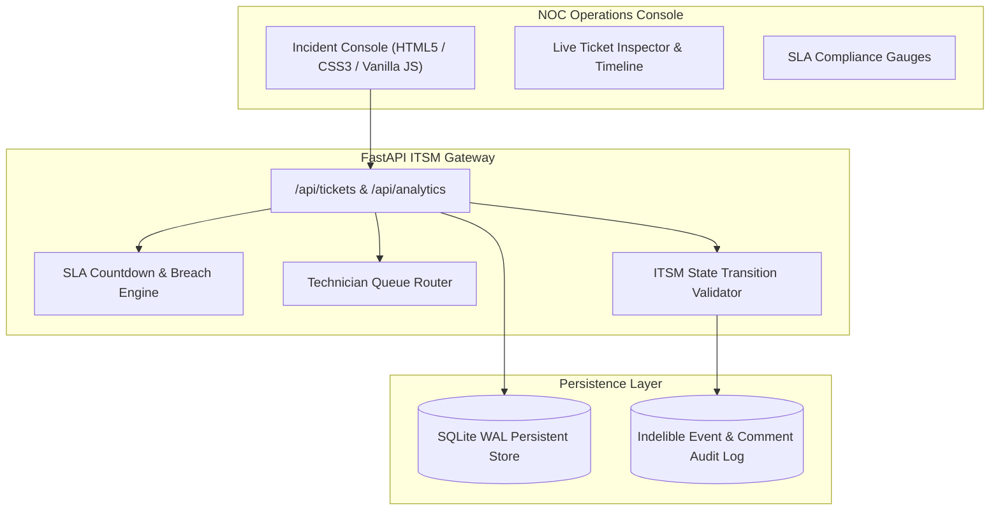

# HelpDesk Pro

[](https://github.com/Soulofghost/helpdesk-pro/actions/workflows/ci.yml)
[](LICENSE)
[](https://www.python.org/downloads/)
[](https://fastapi.tiangolo.com)
[]()

> **HelpDesk Pro** is an enterprise IT Service Management (ITSM) and Incident Management platform. It features real-time Service Level Agreement (SLA) breach countdown timers, priority severity matrix escalation queues, technician category routing, and structured root-cause resolution workflows.

---

## 🏛️ System Architecture



---

## ⚡ Core Engineering Capabilities

1. **SLA Policy Matrix & Real-Time Breach Engine (`ticket_sla.py`)**
   - Automatically calculates target response and resolution deadlines at ticket ingestion:
     - **CRITICAL (P1):** 1 hour response, 4 hours resolution $\to$ auto-escalates to *Tier 3 Critical Response*.
     - **HIGH (P2):** 2 hours response, 8 hours resolution $\to$ routes to *Tier 2 Infrastructure & Ops*.
     - **MEDIUM (P3):** 4 hours response, 24 hours resolution $\to$ routes to *Tier 1 General Support*.
     - **LOW (P4):** 8 hours response, 72 hours resolution $\to$ routes to *Tier 1 General Support*.
   - Evaluates dynamic countdown states:
     - `HEALTHY`: $> 1$ hour remaining in SLA window.
     - `AT_RISK`: $\le 1$ hour remaining prior to breach.
     - `BREACHED`: Deadline exceeded while ticket remains unresolved.
     - `MET`: Ticket resolved within SLA deadline.

2. **Automated Category Routing**
   - Directs incident triage based on operational domain:
     - `Security & IAM` $\to$ Alex Rivera (SecOps Lead)
     - `Network & Infrastructure` $\to$ Marcus Vance (NetOps)
     - `Hardware & Devices` $\to$ Elena Rostova (Hardware Tech)
     - `Software & Applications` $\to$ Liam Chen (SysAdmin)
     - `General & Access` $\to$ Sarah Connor (Service Desk)

3. **ITSM Lifecycle State Machine**
   - Enforces transition governance:
     $$\text{OPEN} \longrightarrow \text{ASSIGNED} \longrightarrow \text{IN\_PROGRESS} \rightleftharpoons \text{PENDING\_CUSTOMER} \longrightarrow \text{RESOLVED} \longrightarrow \text{CLOSED}$$
   - Resolution Gate: Tickets cannot transition to `RESOLVED` without technical root-cause documentation.

4. **Bi-Directional Comment & Event Trail**
   - Segregates customer-facing replies from internal technician notes.
   - Automatically timestamps first response time upon initial support technician interaction.

---

## 🔌 API Reference

| Method | Endpoint | Description |
|---|---|---|
| `GET` | `/api/health` | Health status and engine version |
| `GET` | `/api/tickets` | Query incident queue (filters: priority, status, category, search) |
| `POST` | `/api/tickets` | Dispatch new incident (auto-generates HDK-xxxx, calculates SLA) |
| `GET` | `/api/tickets/{id}` | Full ticket telemetry with live SLA countdown and timeline |
| `PATCH` | `/api/tickets/{id}/status` | Execute state machine transition (`IN_PROGRESS`, `RESOLVED`, etc.) |
| `PATCH` | `/api/tickets/{id}/assign` | Reassign ticket to technician or escalation tier |
| `POST` | `/api/tickets/{id}/comments` | Post public reply or internal technician note |
| `GET` | `/api/analytics/sla-metrics` | Telemetry on SLA compliance rate, breaches, and priority volume |

---

## 🚀 Getting Started

### Local Development

1. **Clone repository:**
   ```bash
   git clone https://github.com/Soulofghost/helpdesk-pro.git
   cd helpdesk-pro
   ```

2. **Install dependencies:**
   ```bash
   pip install -r backend/requirements.txt
   ```

3. **Run tests:**
   ```bash
   pytest backend/tests -v
   ```

4. **Start the application:**
   ```bash
   uvicorn backend.app.main:app --reload --port 8000
   ```
   Open `http://localhost:8000` to access the NOC Incident Console.

---

### Docker Deployment

```bash
docker-compose up --build -d
```

---

## 👨‍💻 Author

**Alvin MS**  
GitHub: [@Soulofghost](https://github.com/Soulofghost)
